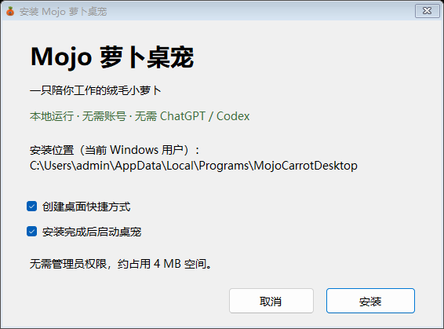
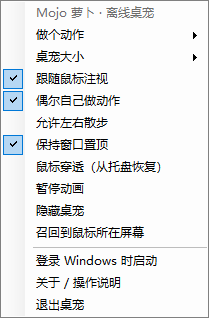

# Mojo 萝卜桌宠 · Mayday Bobo

独立运行的 Windows 绒毛萝卜桌宠。**完全离线，无需 ChatGPT、Codex、账号或 API Key。** 全部图片嵌入程序。


## 下载与安装

- **[下载安装包 v1.0.0](https://github.com/Charliesmzsm/mayday_bobo/releases/download/v1.0.0/MojoCarrot-Setup-1.0.0.exe)**：推荐，双击安装，含快捷方式与卸载入口。
- **[下载便携版 v1.0.0](https://github.com/Charliesmzsm/mayday_bobo/releases/download/v1.0.0/MojoCarrot-Portable-1.0.0.zip)**：解压后双击 MojoCarrot.exe。
- [全部版本](https://github.com/Charliesmzsm/mayday_bobo/releases) · [SHA256 校验文件](https://github.com/Charliesmzsm/mayday_bobo/releases/download/v1.0.0/SHA256SUMS.txt)

面向 Windows 10 / 11，需要 .NET Framework 4.8 系统组件；无需 Python、Node.js 或开发工具。当前版本在 Windows 11 实机验证。

1. 下载并运行安装包。
2. 选择桌面快捷方式、安装后启动选项。
3. 点击“安装”，仅安装至当前用户，无需管理员权限。
4. 右键桌宠或托盘图标打开菜单。

安装包尚未数字签名，Windows 可能提示“未知发布者”或 SmartScreen。请核对来源和 SHA256，不需要关闭系统防护。

```powershell
Get-FileHash .\MojoCarrot-Setup-1.0.0.exe -Algorithm SHA256
```



## 操作

- 拖动移动，单击叶片招手，双击开心跳跃。
- 9 种动作、16 个鼠标注视方向。
- 大小：60%、75%、100%、125%、150%、200%。
- 右键菜单支持置顶、暂停、隐藏、穿透、自动动作和散步。
- 双击托盘可显示桌宠并关闭鼠标穿透；“召回到鼠标所在屏幕”可以找回桌宠。
- 默认开启注视和偶尔自动动作；默认关闭散步、开机启动、鼠标穿透。
- 退出：右键菜单 → 退出桌宠。托盘图标可能位于任务栏隐藏图标区域。



## 安装位置与卸载

- 程序：%LOCALAPPDATA%\Programs\MojoCarrotDesktop
- 设置：%APPDATA%\MojoCarrotDesktop\settings.xml
- 卸载：Windows 设置 → 应用，或开始菜单的卸载入口。
- 卸载保留设置和程序文件夹内用户额外放入的文件。清除设置前请先退出程序。
- 安装版与便携版共享当前用户设置，同一登录会话只运行一只。
- 便携版若启用登录启动，请保持 EXE 路径不变。
- 卸载器从临时目录运行以移除自身；小型临时副本留待系统清理，不会自动再次运行。

## 源码编译

C#、WinForms、Win32 分层窗口、.NET Framework；无 NuGet 或网络构建依赖。

```powershell
git clone https://github.com/Charliesmzsm/mayday_bobo.git
cd mayday_bobo
powershell.exe -NoProfile -File .\build.ps1
```

脚本调用 Windows .NET Framework 的 C# 编译器，优先 Framework64、回退 Framework。若受执行策略限制，请按组织允许的方式执行，不必全局关闭安全策略。

输出位于 build/：MojoCarrot.exe、Uninstall.exe、MojoCarrot-Setup-1.0.0.exe。

```text
src/Pet.cs             桌宠窗口、动画、交互、设置与自检
src/Setup.cs           中文安装器与隔离测试
src/Uninstall.cs       卸载入口
src/InstallCommon.cs   路径、快捷方式、注册与清理
src/app.manifest       权限、兼容和 DPI 声明
assets/               内嵌图集、图标与使用说明
build.ps1             离线编译脚本
docs/                 预览与验证说明
```

## 验证与限制

已验证透明窗口、全部动作/方向、点击交互、尺寸切换、穿透恢复和隔离部署/卸载，见 [验证说明](docs/VALIDATION.md)。尚未在其他电脑、ARM64 和全部多显示器/DPI 组合验证。跨动作体型差异继承原始素材。

## 隐私与素材

无网络请求、遥测、自动更新、聊天或大模型功能，设置仅保存在本机。

角色素材由项目发起者提供。暂未声明开源许可证；公开源码不等于授权第三方商用或再分发，使用前请联系仓库所有者确认。

问题反馈：[Issues](https://github.com/Charliesmzsm/mayday_bobo/issues)。

