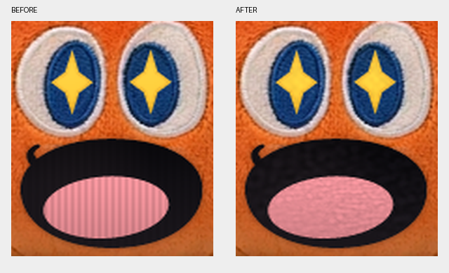

# Mojo 萝卜 v1.1.1 美术修整与验证

日期：2026-10-22。局部材质优化已接入本地构建；尚未上传仓库或发布新版 Release。原 v1.1.0 交付包保留，README 的公开下载仍指向已发布的 v1.0.0。

## 已实际完成

惊喜48帧中F08–F46共39帧的黑嘴、粉舌和黄色星形内部进行了局部材质处理；中性首尾帧保持原样。方法是确定性去除周期竖纹，再将用户实拍参考中的少量高频刺绣明暗投射到原有区域，没有调用生成模型、重画角色或增加姿势。嘴腔新增细微明暗，200%放大时略有斑驳，仍可继续人工细化。

实拍只用作材质参考，裁取舌头(510,1210,700,1320)、黑绣线(415,995,550,1080)、黄色针脚(480,678,508,716)。没有导入照片透视、脸部比例、背景、文字和标签。裁片随素材包保存。

48帧的alpha逐像素完全不变；所有编辑蒙版外像素完全不变，身体、叶片、眼圈、蓝眼底、缝线、口型轮廓、帧顺序、画布384×416与锚点[192,392]保持。蒙版只覆盖不透明区域内部，边缘留出安全圈。每帧有原图、修后图、编辑蒙版和像素SHA256，可定位或回退。

舌头红通道的周期分量平均幅值从16.094降到0.482，约降低97.0%。这是针对原有规律竖纹的测量，不能当作整体美术质量提升百分比。星形细节幅度很小，100%下效果较克制。

## 查看和验证范围

- 已打开中性/批准惊喜参考、实拍材质裁片、前后局部对照、深浅底48帧接触表，以及60%/100%/200%的深浅底对照截图。独立视觉复核结论为“局部材质修整通过，整体美术完成度仍需修整”；未见新增双眼、双嘴、星形增减、透明洞或裁切。
- Chrome实际正常速度播放2.3秒，观察到全部48个帧索引，页面无错误；HTML使用精确41/42ms时间表，共2000ms，并支持暂停逐帧。已分别在深底和浅底捕获全部48帧。元素截图因子像素取整多出1行背景，接触表保留该行，没有重采样素材。
- 原生Win32透明窗口按正常速度跑过全部13个资源集（12动作+注视）。惊喜实际2025ms；60/100/200%切换、单/双击判定、拖动取消、暂停/隐藏/模拟锁屏、菜单、穿透召回和移动边界检查通过。
- 完整交付源码ZIP已解压到独立目录离线重编译成功，主程序/安装器/卸载器版本均1.1.1.0。最终v1.1.1自检5412项断言通过，包含旧图集兼容自检；安装器verify和隔离test-install通过。帧/页缓存峰值33,546,240/16,613,376字节，均在32/16MiB预算内；GDI自检3→3，窗口初始化后两轮绘制均60。
- 原生正常播放18.690秒，CPU2.422秒，约单核12.96%；压力段24.525秒，CPU8.156秒，约单核33.26%，含集中绘制，不代表日常待机负载。压力测试工作集164,663,296字节。

自动播放与逐帧静态检查不能证明所有动态闪烁均通过人工验收；尚未逐帧人工查看全部406帧在所有尺度背景的组合。未执行真实系统锁屏、长时间泄漏/功耗、跨机安装、全部DPI/多屏组合；本版未另跑一次强制旧模式的原生窗口，旧兼容自检已重跑。隔离安装测试不等同于正式覆盖安装。

## 仍需美术修整：具体帧与最小范围

1. surprise_star F08、F46：开口/收口经过薄直线。只修F07–F11与F43–F47嘴部轮廓，锁定身体、眼睛和两端关键帧；本次没有改口型。
2. surprise_star F12、F43：暗粉舌头的过渡可进一步统一。只细化舌头与黑嘴的局部材质明暗，避免忽然跳亮或变灰。
3. 共享叶冠及身体外缘：200%深底可见浅边，特别是F20/F33对照。可能混有自然绒毛高光，只对确认受污染的外沿1–2源像素修RGB；本次没有侵蚀alpha或盲目去边。
4. idle_breathe F32→F01与hop_left/hop_right F24→F01：既有约1–2源像素的微小循环边界差。后续只修首尾各2–4帧的运动曲线，不复制首帧遮掩接缝。

[完整分项提示词](ART-RETOUCH-PROMPTS.md)包含中英文保形主提示词、嘴舌材质、星形刺绣、口型过渡、透明边缘、循环接缝与逐帧验收要求。口型编辑规则单独覆盖嘴轮廓锁定，避免与材质任务冲突。

## 48帧是否是真实阶段变化

F01–F07中性/察觉预备；F08–F10小口与星眼出现；F11–F16嘴舌展开、爆发；F17–F32开心停留与轻微身体/叶片变化；F33–F40余兴回弹；F41–F48收势回到中性。

有47个不同像素图像，F01=F48。阶段变化存在，并非将少数旧图集姿势重复凑数；但中段主要是同一姿势的连续变形，余兴差异较细，不能宣称48个独立手绘关键姿势。本次只修材质，没有新增表演阶段或提高原素材帧数。GIF受10ms粒度限制，准确节奏以HTML和程序为准。

## 素材与交付

运行库仍为12动作390帧与16注视，共406帧。仅替换surprise_star的6张分页PNG，其他动作保持。完整资源名、来源、帧矩形、锚点和像素校验见源码docs/ASSET-MANIFEST.json与assets/motion/animations.json。旧图集仍嵌入用于兼容。

修整包含48张原帧、48张修后帧、48张蒙版、6张原/修后运行页、实拍裁片、差异记录、深浅底接触表、60/100/200%对照图、GIF和离线HTML。透明PNG原图保留真实alpha；预览背景不属于素材。

正常速度对照HTML与完整修整素材包作为本地交付附件保存；仓库内保留局部对照及GIF。

